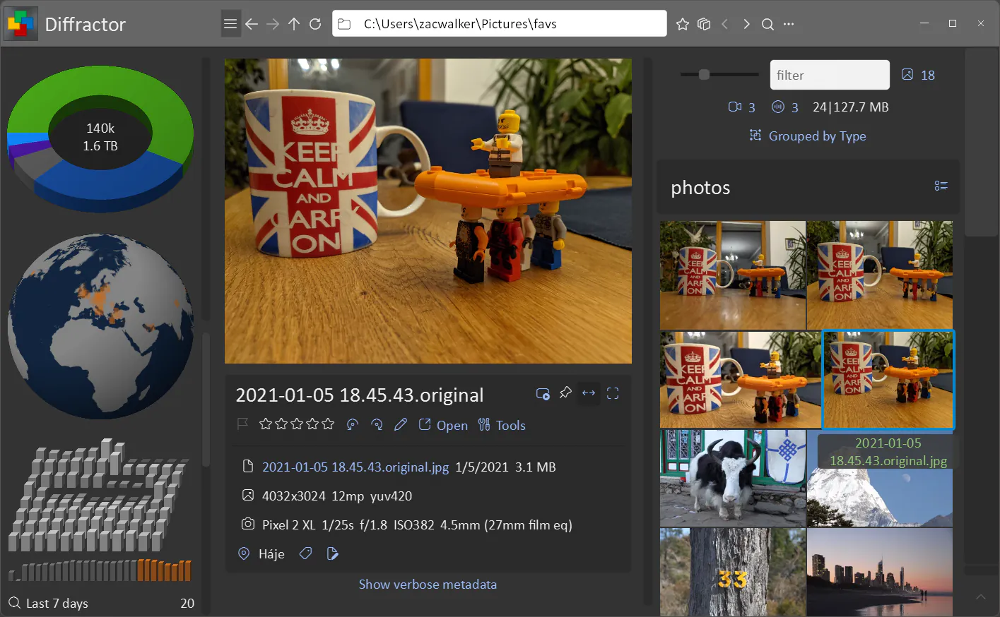

# Diffractor
[](https://github.com/ZacWalk/diffractor/actions/workflows/windows.yml)

Free, high-performance photo and video organizer for Windows. Optimized for speed and local file control—no cloud storage or subscriptions required.



## Features

| Category | Capabilities |
|----------|-------------|
| **Viewing** | Unified photo/video/audio playback; native support for most formats including RAW |
| **Zoom** | One scale-and-center model across mouse, keyboard, wheel, and touch; hold to inspect, an overview navigator, and linked side-by-side magnification |
| **Search** | Instant metadata-based search (tags, location, camera data) via local indexing |
| **Places** | Photos and videos are placed from GPS alone, searchable by place, city, state, country, or distance, with map and visit-derived grouping |
| **Metadata** | Read/write XMP, IPTC, EXIF, ID3; add tags, ratings, location |
| **Organization** | Side-by-side comparison, and duplicate detection ("Presence") that recognizes a re-encoded, resized, or rotated copy as well as an identical one |
| **Related items** | Finds possible copies, the same album, the same series, and the closest capture times and places, each as its own group |
| **File operations** | Rename, Import, and Sync preview every file before they run, and state how each name collision will be resolved |
| **Sync** | Bidirectional sync to NAS/network drives for backup and collaboration |
| **Editing** | Resize, rotate, crop, perspective, temperature and tint, color adjustment, and automatic color, straighten, and document correction |
| **Languages** | English plus 13 translation catalogs |

## Building

```bash
git clone https://github.com/ZacWalk/diffractor.git
```

The build uses CMake and requires Visual Studio and Ninja. CMake fetches the dependencies at the
versions `cmake/dd-dependencies.json` pins, upstream [FFmpeg](https://github.com/FFmpeg/FFmpeg)
among them.

Everything goes through the `dd` gateway, which finds Visual Studio, configures with Ninja and puts the binary in `exe/`:

```powershell
.\dd.ps1 test                                            # build, lint, test, check translations
python tools/dd.py build --config Release --arch x86     # the 32-bit desktop binary
python tools/dd.py build --winstore                      # the Store binary
```

Release packaging also requires NSIS, the Windows SDK, and a code-signing certificate; `dd.ps1`
fetches the 7-Zip it packs with. Run `.\dd.ps1` for the complete command list.

Product behavior is documented in [docs/design.md](docs/design.md). Architecture is
documented in [docs/implementation.md](docs/implementation.md), whose links lead to
the specialized subject documents. Contributor routing and repository rules are in
[AGENTS.md](AGENTS.md).

## Rendering Movie projects from the command line

Movie projects can be checked, imported and rendered without opening a window. Import turns each
Windows Live Movie Maker `.wlmp` project into a native `.otio` one, finding its moved sources in your
collection; render makes a movie from a native project. How moved sources are found again is described
in [docs/movie.md](docs/movie.md#6-project-files), and the switches in
[docs/movie.md](docs/movie.md#9-command-line).

| Switch | Effect |
|--------|--------|
| `-movie-check:<project or folder>` | Reports what import would make of each `.wlmp`, or what render would find in each `.otio`. Writes nothing |
| `-movie-import:<project or folder>` | Writes a native `.otio` project for each `.wlmp`, with sources found in the collection |
| `-movie-render:<project or folder>` | Writes an `.mp4` for each `.otio` project whose sources are all usable |
| `-movie-media:<folder>` | Also searches this folder and its subfolders, by name, for sources missing from their stored paths |
| `-movie-out:<folder>` | Sets where imported projects or rendered movies go. By default each goes beside its project |
| `-movie-overwrite` | Replaces a project or movie that already exists instead of skipping it |
| `-movie-skip-missing` | Renders without the clips whose source cannot be used |

```powershell
.\exe\diffractor64.exe -movie-check:D:\Projects | Out-Host
.\exe\diffractor64.exe -movie-import:D:\Projects | Out-Host
.\exe\diffractor64.exe -movie-render:D:\Projects -movie-out:D:\Movies | Out-Host
```

Paths must be full paths. Quote the whole switch when a path contains a space, as in
`"-movie-import:D:\My Projects\trip.wlmp"`. Piping into `Out-Host` makes PowerShell wait and show the
report as it is written.

## Contributing

Contributions are coordinated through [GitHub issues](https://github.com/ZacWalk/diffractor/issues).
Use [Poedit](https://poedit.net/) for catalogs under `exe/languages`, and run
`.\dd.ps1 test` before submitting a change.

## License

Diffractor is free software.

**Diffractor's own source** — everything in `src/`, `tools` and `cmake/` — is licensed under the
**GNU Lesser General Public License, version 2.1 or later**.

**Released binaries are licensed under the LGPL, version 3.0 or later.** They statically link
[libheif](https://github.com/strukturag/libheif) and [libde265](https://github.com/strukturag/libde265),
both of which are LGPL-3.0-or-later, and LGPL 2.1 cannot absorb LGPL 3 code. Because Diffractor's own
code is offered as "2.1 or later", the combined work resolves to 3.0 or later. Anyone who removes
those two dependencies may use the remaining Diffractor code under 2.1.

The full texts are in [LICENSE](LICENSE) (LGPL-3.0) and [COPYING.GPLv3](COPYING.GPLv3), which LGPL-3.0
incorporates by reference.

The executable also statically links [libdesktop](https://github.com/ZacWalk/libdesktop)
and [libfiles](https://github.com/ZacWalk/libfiles), both LGPL-2.1-or-later. Before
distributing a binary, provide the corresponding source for its exact library revisions
(including modifications), the notices and licence texts, and the application source
and build scripts or relinkable object files needed to rebuild with modified libraries.
For the combined LGPL-3.0-or-later binary, follow LGPLv3 section 4, including any
required installation information. Recipients must be permitted to modify the libraries
and reverse-engineer the combined work to debug those modifications.

Verify the release materials by rebuilding with a modified library using the documented
compiler, configuration and dependencies. This notice and a link to the latest source
are not themselves a relinking package.

Fetched dependencies and their terms are listed in
[docs/third-party.md](docs/third-party.md#licensing). FFmpeg is deliberately configured with
`CONFIG_GPL 0`, so no GPL-only component is included and it is used under the LGPL.
