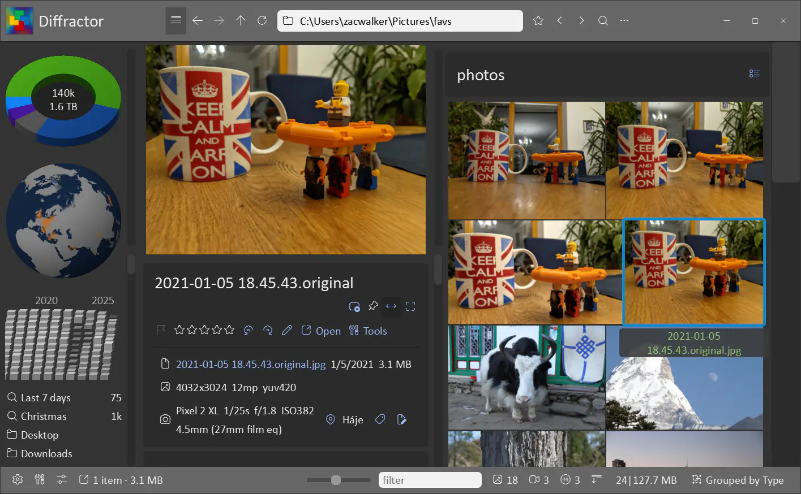

# Diffractor
[](https://github.com/ZacWalk/diffractor/actions/workflows/windows.yml)

Free, high-performance photo, video and audio organizer for Windows. Optimized for speed and local
file control—no cloud storage or subscriptions required. A Linux build runs but is not distributed;
see [docs/linux.md](docs/linux.md).



## Features

| Category | Capabilities |
|----------|-------------|
| **Viewing** | Unified photo/video/audio playback; native support for most formats including RAW; Commodore 64 SID tunes, with a voice-by-voice SID monitor; C64 disks, tapes, cartridges and programs run in a built-in Commodore 64 emulator |
| **Zoom** | One scale-and-center model across mouse, keyboard, wheel, and touch; hold to inspect, an overview navigator, and linked side-by-side magnification |
| **Search** | Instant metadata-based search (tags, location, camera data, RAW, HDR and animation, and the files on a C64 disk) via local indexing |
| **Places** | Photos and videos are placed from GPS alone, searchable by place, city, state, country, or distance, with map and visit-derived grouping |
| **Metadata** | Read/write XMP, IPTC, EXIF, ID3; add tags, ratings, location |
| **Organization** | Side-by-side comparison, and duplicate detection ("Presence") that recognizes a re-encoded, resized, or rotated copy as well as an identical one |
| **Related items** | Finds possible copies, the same album, the same series, and the closest capture times and places, each as its own group |
| **File operations** | Rename, Import, and Sync preview every file before they run, and state how each name collision will be resolved |
| **Sync** | Bidirectional sync to NAS/network drives for backup and collaboration |
| **Editing** | Photos: resize, rotate, crop, perspective, temperature and tint, color adjustment with a live histogram, a before-and-after handle, and automatic color, straighten, and document correction. Videos and sound files: lossless trim, sound removal, rotation, and a re-muxed copy - in the file's own format or as an MP4 - that can repair a file other players will not play |
| **Languages** | English plus 13 translation catalogs |

## Building

```bash
git clone https://github.com/ZacWalk/diffractor.git
```

The build uses CMake and requires Visual Studio with the C++ workload, Ninja, Python 3 and
PowerShell 7. CMake fetches the dependencies at the versions `cmake/dd-dependencies.json` pins,
upstream [FFmpeg](https://github.com/FFmpeg/FFmpeg) among them.

Everything goes through the `dd` gateway, which finds Visual Studio, configures with Ninja and puts the binary in `exe/`:

```powershell
python tools/dd.py build                                 # Debug x64: exe\diffractor64-d.exe
python tools/dd.py build --config Release                # Release x64: exe\diffractor64.exe
.\dd.ps1 test                                            # build, lint, test, check translations
.\dd.ps1 test --label headless                           # the same complete gate, no visible UI
python tools/dd.py build --config Release --arch x86     # the 32-bit desktop binary
python tools/dd.py build --winstore                      # the Store binary
.\dd.ps1 linux                                           # build the Linux binary in WSL and run it
.\dd.ps1 vs                                              # debug the Debug build in Visual Studio
```

Release packaging also requires NSIS, the Windows SDK, and a code-signing certificate; `dd.ps1`
fetches the 7-Zip it packs with. Run `.\dd.ps1` for the complete command list, and see
[docs/testing.md](docs/testing.md) for running some of the tests and the windowless gate.

Product behavior is documented in [docs/design.md](docs/design.md). Architecture is
documented in [docs/implementation.md](docs/implementation.md), whose links lead to
the specialized subject documents. Contributor routing and repository rules are in
[AGENTS.md](AGENTS.md).

### Icon artwork

`python tools\generate_icon.py` uses the interlocking square geometry from
`tools\logo.html` with a saturated palette for desktop and installer ICOs, logo PNGs and Linux artwork.
`python tools\generate_icon.py --check` checks the committed bytes without writing.
For another size, use `--output tmp\icon-128.png --size 128`.
`python tools\generate_store_assets.py --output exe\Assets` produces Store artwork
from the same vectors; it also accepts `--check`. Both use Python 3.9+'s standard
library and the self-contained `tools\iconlib.py`, with no fonts or Pillow required.

## Opening files

Opening a file normally reuses the running Windows window. Turn off **Reuse
existing window when opening files** in Options to keep separate windows, or
pass `-new-window` for one launch. See [navigation behavior](docs/design.md#options).

## Command line

| Switch | Effect |
|--------|--------|
| `<file or folder>` | Opens it. A folder ending in `**` opens with its subfolders |
| `-new-window` | Opens a window of its own rather than reusing the running one |
| `-no-gpu` | Draws with the software renderer |
| `-no-indexing` | Leaves the collection unindexed |
| `-profile:<folder>` | Keeps settings, the index and map tiles in that folder rather than your own |
| `-collection:<folder>` | Makes one folder the whole collection; without `-profile`, its settings are kept in `<folder>-profile` |
| `-mcp`, `-mcp-ui:`, `-mcp-allow:` | Serves Diffractor's tools to an AI agent on stdin and stdout: see [docs/agents.md](docs/agents.md) |
| `-tool:<name> name=value ...` | Calls one of those tools once and prints its answer: see [docs/agents.md](docs/agents.md#10-a-single-call-from-the-command-line) |
| `/test[:<filter>]`, `-test-temp:<folder>` | Runs the test suite, or the tests the filter names: see [docs/testing.md](docs/testing.md) |
| `-validate-po` | Checks the translations under `exe/languages` |

An agent session searches the library, checks and renders Movie projects, drives the window, takes
screenshots, records the window and plays tutorial scripts for tutorial videos. Paths are full paths;
quote a switch or a `name=value` pair whose path has a space.

## Rendering Movie projects

A Movie project is a `.dfv` file: plain text, one item per line in the order they play, which a person
or an agent can write. The `movie_check` and `movie_render` tools check and render projects without
opening a window, from an agent session or the command line. The format is in
[docs/movie.md](docs/movie.md#6-project-files), and what the tools do and report in
[docs/movie.md](docs/movie.md#9-checking-and-rendering-without-the-window).

```powershell
.\exe\diffractor64.exe -tool:movie_render projects=D:\Projects output=D:\Movies 2>&1 | Out-Host
```

## Contributing

Contributions are coordinated through [GitHub issues](https://github.com/ZacWalk/diffractor/issues).
Use [Poedit](https://poedit.net/) for catalogs under `exe/languages`, and run
`.\dd.ps1 test` before submitting a change.

## License

Diffractor's source code is licensed under the [Mozilla Public License 2.0](LICENSE), as are
[libdesktop](https://github.com/ZacWalk/libdesktop) and [libfiles](https://github.com/ZacWalk/libfiles),
which it is built on. Anyone distributing a binary must tell its recipients where to get that source
code, including any changes made to it.

A released binary also includes libraries under the LGPL: libheif and libde265 (LGPL-3.0-or-later),
FFmpeg (LGPL-2.1-or-later, configured with `CONFIG_GPL 0` so that no GPL-only component is included),
and the code libfiles ports from libexif and libiptcdata (LGPL-2.1-or-later). Before distributing a
binary:

- Ship their licence texts beside it, as every release package does from [licences](licences): the
  LGPL-3.0, the GPL-3.0 it incorporates, and the LGPL-2.1.
- Let its users relink it with modified versions of those libraries (LGPL-2.1 section 6, LGPL-3.0
  section 4): provide the corresponding source of their exact revisions, including changes, and the
  application source and build scripts or object files needed to rebuild it. A link to the latest
  source alone is not a relinking package.
- Permit modification for the recipient's own use and reverse engineering to debug those
  modifications.

libaom, the AV1 encoder libfiles writes AVIF with, is under the BSD 2-Clause licence and the Alliance
for Open Media Patent License 1.0, each of which asks for its text with a binary: every release package
carries both beside the program, from [licences](licences). The other fetched libraries keep their own
licences and notices; the [dependency inventory](docs/third-party.md#dependency-inventory) lists them all.
